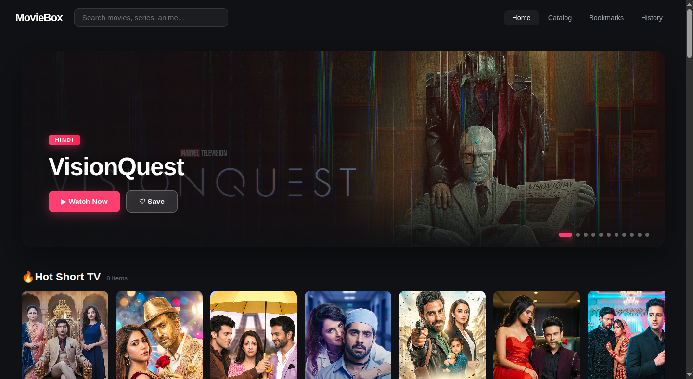
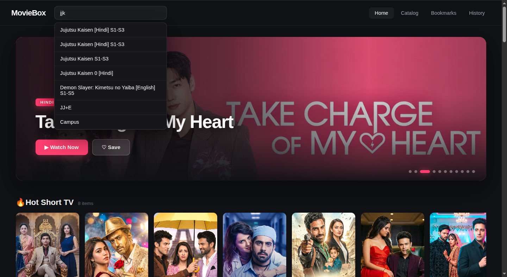
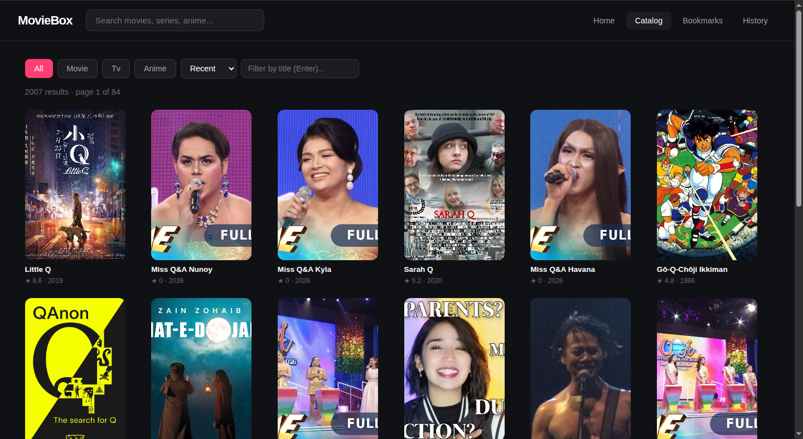
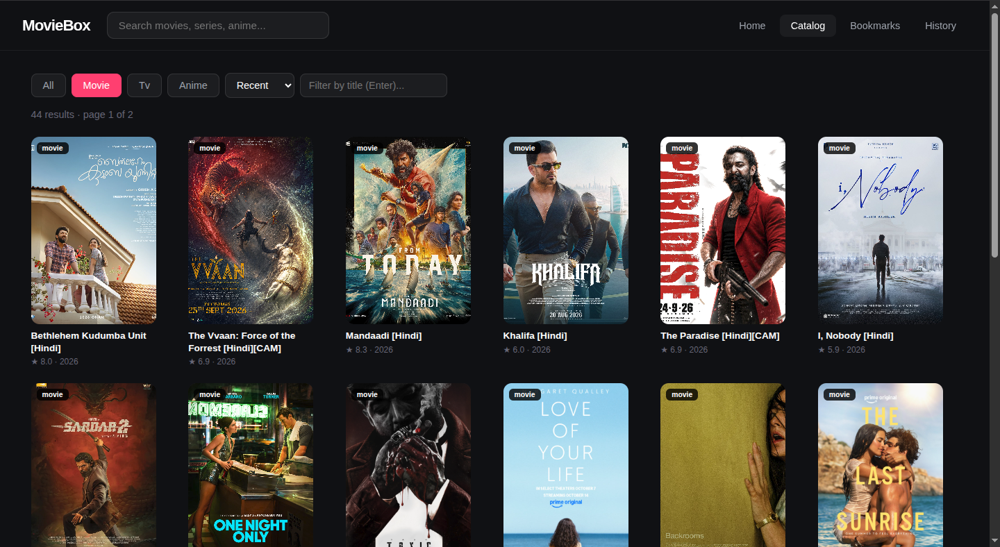
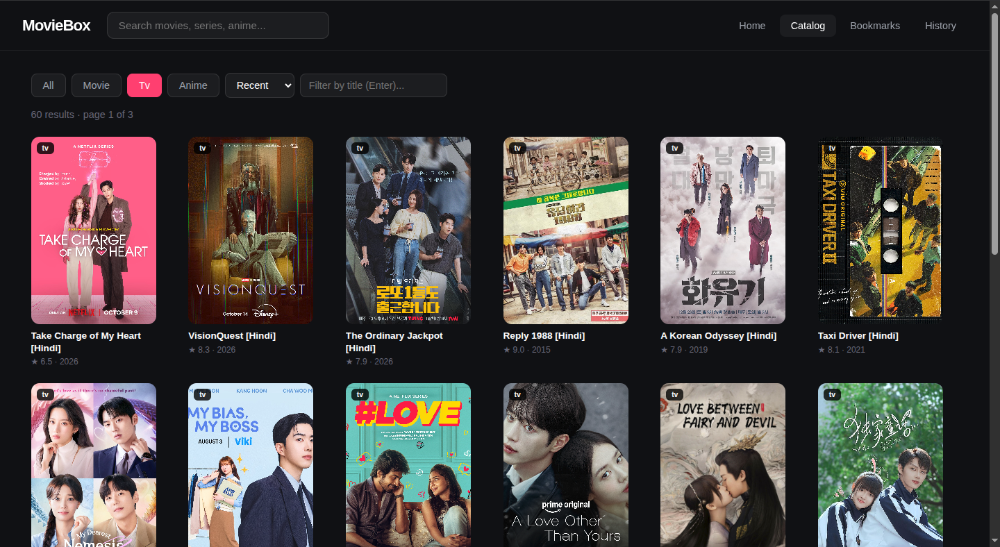
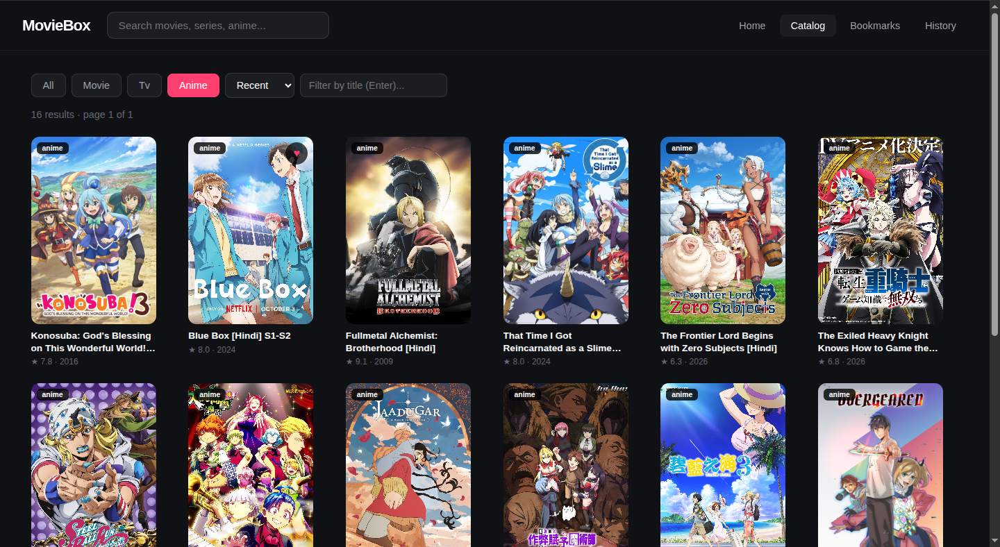
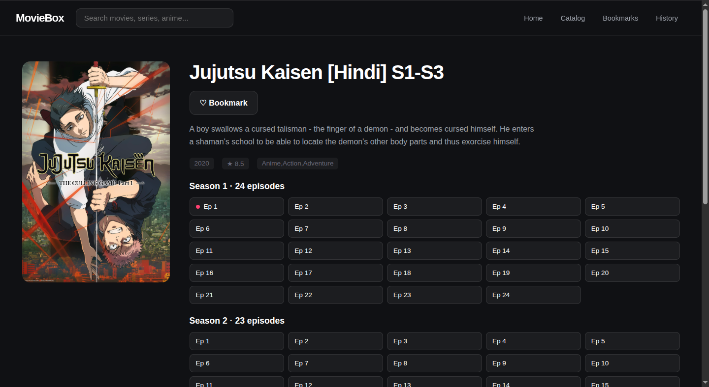
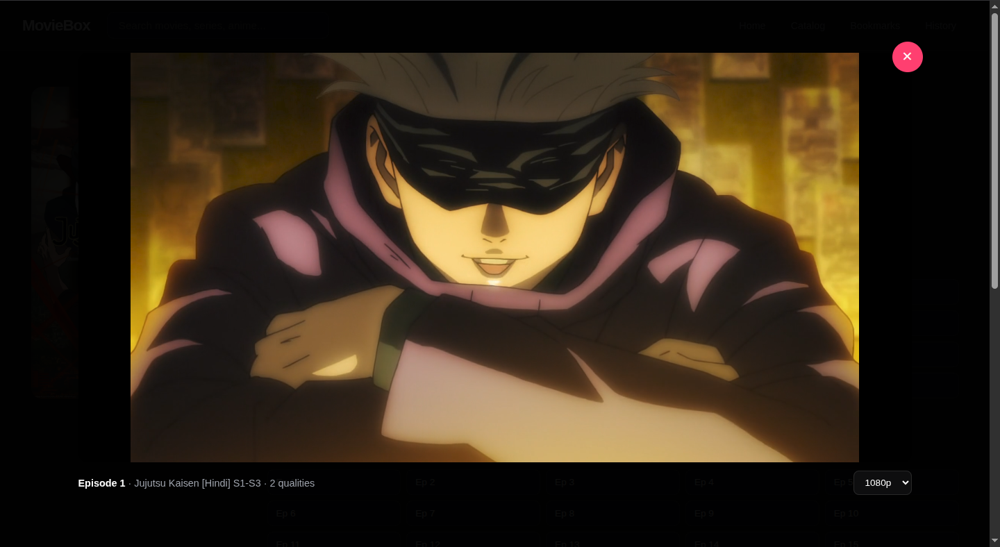
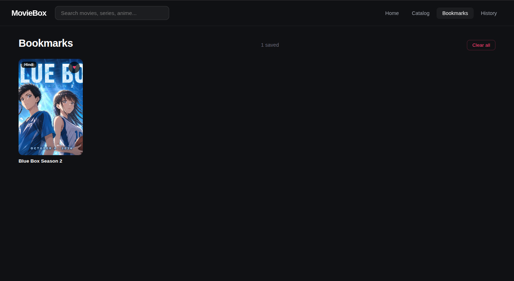
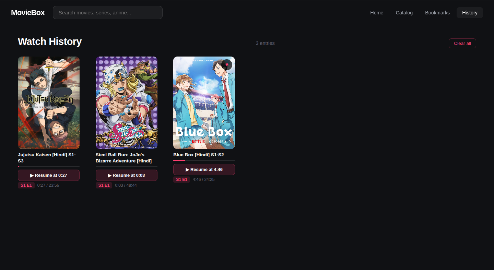

# Screenshots

A visual tour of MovieBox API Pro's frontend at `/app`. Every image is a real
frame from a running instance — no mockups, no faked data.

All screenshots are 1440×900, captured with light UI polish, browser zoom 100%.

---

## Home

The landing page. Hero carousel auto-rotates every 6 seconds with Ken Burns
zoom on the backdrop. Arrows and dots appear on hover. Below the hero, every
home section renders as a horizontal scroll row with poster cards.



---

## Search

Typeahead in the header. Hits `/search/suggest?enrich=true` after 300ms of
typing. Shows titles only — click to navigate to the detail page. Slugs are
resolved via a second `/search` call per suggestion.



---

## Catalog

The indexed catalog. 1700+ subjects backed by SQLite, refreshed every 6 hours.
Type tabs, sort dropdown, and title filter all live-update the URL so the page
state is bookmarkable.



### Filtered by type

Each type filter reads from the SQLite index — counts are real, not
sentinel-stubbed. `type=movie` at 400+ after enrichment, `type=tv` at ~350,
`type=anime` at ~100.

<table>
  <tr>
    <td></td>
    <td></td>
  </tr>
</table>



---

## Detail / Episodes

Full metadata page for a subject: poster, description, IMDb rating, genre,
cast chips, dub language links, and either a Play button (movies) or a season/
episode grid (series). Watched episodes get a red dot. Access notes explain
upstream's free-episode rules without implying a gate.



---

## Player

Modal overlay. HTML5 `<video>` streaming through `/api/stream/{sid}/proxy`
with Range support — seeking works out of the box. Quality picker (top right),
subtitle picker (right of quality), resume toast if you've watched before,
keyboard shortcuts for space/arrows/f/m/esc. Subtitles render from
`/api/stream/{sid}/subtitles/{lang}` as native `<track>` elements.



---

## Bookmarks

Every poster has a heart button that appears on hover. Clicking saves the
title to `localStorage` under `mb_bookmarks`. The Bookmarks page lists
everything saved, sorted by save time, with a Clear all button.



---

## Watch History

Every play session saves progress to `localStorage` under `mb_history`. The
History page lists every entry with a progress bar, "Resume at M:SS" button,
and season/episode badge. Resume opens the player directly at the saved
timestamp.



---

## Regenerating

If the UI changes, re-capture screenshots at 1440×900 with browser zoom at
100% and no chrome visible (use the browser's "hide UI" or devtools screenshot
mode). Keep the file names the same so this README stays in sync.

Suggested tool for consistent captures:

```bash
# Firefox devtools "Take screenshot" — full page, 1440×900 viewport
# or: firefox --screenshot=home.png --window-size=1440,900 http://localhost:8000/app